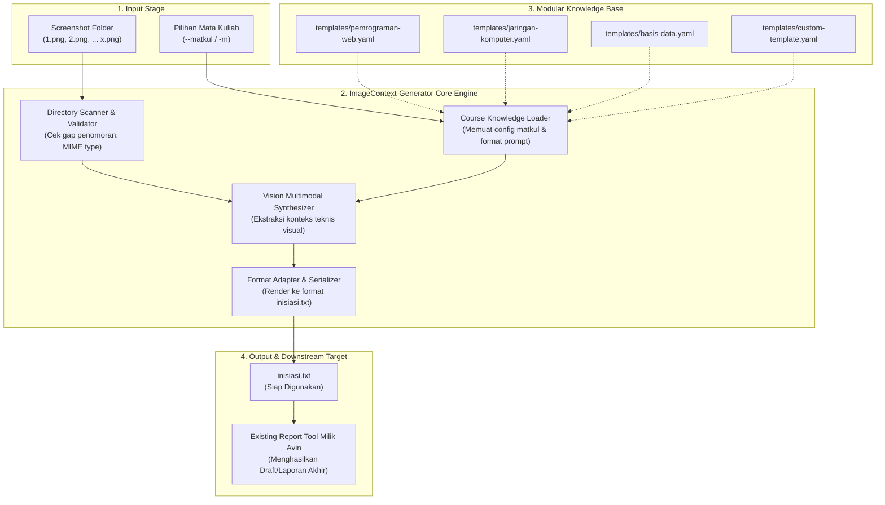
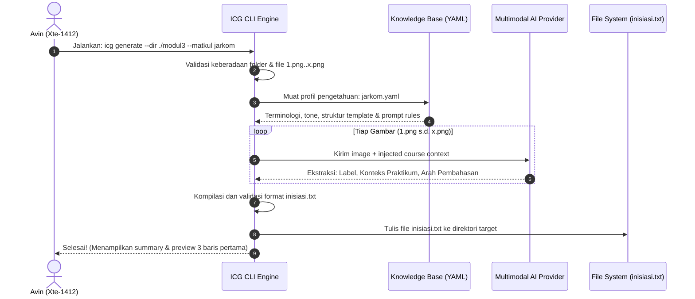

# 📋 Product Requirements Document (PRD)
# ImageContext-Generator (ICG)
### Codename: *Jaou Shingan Context Synthesizer v1.0*

> **Root Repositori:** `C:\laragon\www\ImageContext-Generator`  
> **Status Dokumen:** Master PRD & Living Documentation (Siap Diupdate Berkala)  
> **Target Pengguna / Maintainer:** Hilarius Christiano Avin Paliling (*Xte-1412*)  
> **Karakter Sistem:** Modular Vision-to-Context Generator CLI  
> **Downstream Consumer:** Existing Report Generator Engine milik Avin  

---

## 1. Visi Produk, Latar Belakang & Batasan Ruang Lingkup

### 1.1 Visi Produk (Product Vision)
Menjadi jembatan cerdas (*intelligent bridge*) tanpa friksi yang mengotomasi ekstraksi konteks teknis dari rangkaian screenshot praktikum (`1.png` s.d. `x.png`) menjadi file metadata `inisiasi.txt`. Mengeliminasi proses penulisan catatan manual yang repetitif dan melelahkan, sehingga mempercepat siklus pembuatan laporan praktikum (laprak) dengan akurasi terminologi teknis sesuai silabus mata kuliah terkait.

### 1.2 Latar Belakang Masalah
1. **Beban Tugas & Waktu Terbatas:** Jadwal perkuliahan yang padat serta tumpukan laporan praktikum mingguan membutuhkan efisiensi tinggi.
2. **Tool Downstream Sudah Tersedia:** Pengguna sudah memiliki tools generator laporan otomatis yang andal, namun generator tersebut memerlukan file perantara (`inisiasi.txt`) yang memetakan nomor gambar ke penjelasan konteks/langkah praktikum.
3. **Bottleneck Manual Inisiasi:** Mengetik manual deskripsi langkah untuk puluhan gambar (`1.png` s.d. `x.png`) memakan waktu hingga puluhan menit per modul.
4. **Variasi Konteks Antar-Matkul:** Setiap mata kuliah (mis. Jaringan Komputer, Pemrograman Web, Sistem Basis Data) memiliki terminologi, fokus analisis, dan struktur pemaparan yang berbeda-beda.

### 1.3 Batasan Ruang Lingkup (Scope & Boundaries)
* ✅ **DI DALAM RUANG LINGKUP (IN-SCOPE):**
  * Memindai direktori screenshot yang telah dinamai secara terurut (`1.png`, `2.png`, ..., `x.png`).
  * Validasi integritas urutan gambar (mendeteksi file hilang, ekstensi non-standar, atau *gap* penomoran).
  * Sistem *Knowledge Base* modular berbasis berkas konfigurasi (`YAML`/`JSON`) per mata kuliah yang mudah ditambah/diedit tanpa menyentuh kode inti.
  * Analisis visual berbasis Vision LLM (multimodal) untuk mengenali UI, terminal output, error message, kode sumber, atau diagram skematik.
  * Pembuatan otomatis file `inisiasi.txt` dengan format terstruktur yang 100% kompatibel dengan tool downstream.
  * Mode interaktif (review & koreksi cepat sebelum simpan) dan mode headless/batch CLI.

* ❌ **BATASAN TEGAS (OUT-OF-SCOPE):**
  * **DILARANG membuat generator laporan PDF/DOCX:** Sistem ini berhenti tepat setelah file `inisiasi.txt` berhasil digenerate dan divalidasi.
  * **DILARANG memodifikasi atau me-rename file gambar asli:** File gambar hanya dibaca secara *read-only*.
  * **Bukan tool capture/screenshot:** Pengguna mengambil dan me-rename screenshot secara mandiri sebelum menjalankan tools ini.

---

## 2. Arsitektur Sistem & Alur Aliran Data

### 2.1 Diagram Alur Keseluruhan (End-to-End Pipeline)



### 2.2 Sequence Diagram Proses Eksekusi



---

## 3. Matriks Teknologi & Lingkungan Kerja

| Komponen | Spesifikasi / Pilihan Teknologi | Alasan Pemilihan |
| :--- | :--- | :--- |
| **Bahasa Pemrograman** | Python 3.10+ | Ringan, ekosistem vision AI luas, mudah dieksekusi di Windows. |
| **CLI & Terminal UI** | `argparse` / `Typer` + `Rich` | Memberikan visualisasi progress bar dan tabel hasil analisis di terminal. |
| **Knowledge Base** | Berkas `YAML` (`PyYAML`) | Format deklaratif yang human-readable, mudah ditambah tanpa koding ulang. |
| **Vision Provider** | Multi-Provider Adapter (OpenAI / Gemini / Hermes Native Vision) | Fleksibel beralih provider tergantung ketersediaan API key / local vision. |
| **Image Processing** | `Pillow (PIL)` | Validasi ukuran, format gambar, dan kompresi pra-pengiriman AI jika diperlukan. |
| **Direktori Root** | `C:\laragon\www\ImageContext-Generator` | Lingkungan kerja lokal terpusat sesuai standar project Avin. |

---

## 4. Spesifikasi Modular Knowledge Base per Matkul

Setiap mata kuliah didokumentasikan dalam file konfigurasi mandiri pada direktori `knowledge/courses/<course_id>.yaml`. Struktur ini menjamin sistem **siap diupdate berkala** oleh pengguna atau AI assistant kapan pun kurikulum berubah.

### 4.1 Skema Konfigurasi Mata Kuliah (`schema.yaml`)

```yaml
course_id: "pemrograman-web"
course_name: "Praktikum Pemrograman Web"
code: "TKX201"
description: "Pengembangan aplikasi web modern, frontend, backend API, dan database"

# Panduan analisis visual untuk Vision AI
analysis_guidelines:
  focus_areas:
    - "Tangkapan layar antarmuka pengguna (UI/UX)"
    - "Terminal error, inspect element browser, dan response network"
    - "Struktur direktori project dan editor kode (VS Code)"
  technical_terms:
    - "Route Handler"
    - "RESTful API"
    - "State Management"
    - "Responsive Design"
    - "HTTP Status Code (200, 404, 500)"

# Pola format penulisan baris inisiasi.txt
output_template:
  header: |
    # Inisiasi Otomatis: {course_name}
    # Tanggal: {date}
    # Total Gambar: {total_images}
  
  # Format per baris gambar
  line_pattern: "{index}.png | {label} | Konteks: {context} | Arah: {direction}"

  # Fallback default jika konteks minim
  fallback:
    label: "Tangkapan Layar Praktikum"
    context: "Aktivitas praktikum modul"
    direction: "Analisis alur eksekusi program"
```

### 4.2 Matriks Mata Kuliah Awal (Initial Supported Courses)

| Course ID | Nama Mata Kuliah | Karakteristik Output Inisiasi |
| :--- | :--- | :--- |
| `pemrograman-web` | Pemrograman Web | Fokus pada UI/web, rute API, form input, dan status respons browser. |
| `jaringan-komputer` | Jaringan Komputer | Fokus pada topologi, konfigurasi IP, Packet Tracer, Wireshark, dan routing table. |
| `basis-data` | Sistem Basis Data | Fokus pada ERD, query SQL di console/DBeaver, skema tabel, dan trigger/view. |
| `pemrograman-mobile` | Pemrograman Mobile | Fokus pada layout emulator Android/iOS, lifecycle activity, dan logcat. |
| `sistem-operasi` | Sistem Operasi | Fokus pada CLI Linux (bash), manipulasi permissions, proses, dan memory usage. |

---

## 5. Spesifikasi Kontrak Input & Output

### 5.1 Format Input Gambar
1. **Aturan Penamaan Berkas:**
   * Wajib bernomor urut integer positif: `1.png`, `2.png`, `3.png`, ..., `N.png`.
   * Ekstensi didukung: `.png` (default), toleransi `.jpg`/`.jpeg` jika dikonversi otomatis.
2. **Integritas Penomoran:**
   * Jika ada penomoran melompat (misal `1.png`, `2.png`, `4.png` tanpa `3.png`), sistem akan menampilkan warning konfirmasi kepada pengguna sebelum memproses.

### 5.2 Format Berkas Luaran (`inisiasi.txt`)
Berkas teks murni (Plain Text / UTF-8) disimpan di direktori yang sama dengan folder gambar.

**Contoh Luaran Standar:**
```text
# ========================================================
# INISIASI PRAKTIKUM: Pemrograman Web (Modul 3 - REST API)
# DIGENERATE OTOMATIS OLEH IMAGE-CONTEXT GENERATOR
# ========================================================

1.png | Halaman Login Antarmuka | Konteks: Tampilan form login dengan validasi field email dan password | Arah: Pembahasan implementasi validasi form di sisi klien
2.png | Inspect Element Network Tab | Konteks: Request POST ke endpoint /api/v1/auth dengan status HTTP 200 OK | Arah: Analisis payload request JSON dan token JWT pada response header
3.png | Terminal Server Log | Konteks: Log query database select user berdasarkan email unik | Arah: Penjelasan efisiensi query dan indexing database
4.png | Pesan Error Validasi Kredensial | Konteks: Alert toast berwarna merah saat password salah diinputkan | Arah: Evaluasi user experience dan mekanisme penanganan error
```

---

## 6. Struktur Direktori Proyek (Final Organized)

```text
C:\laragon\www\ImageContext-Generator/
├── PRD.md                              <-- Dokumen Master Ini
├── README.md                            <-- Petunjuk Cepat Penggunaan
├── requirements.txt                     <-- Dependensi Python
├── .env.example                         <-- Template API Key (Copy ke .env)
│
├── knowledge/                           <-- 🔧 MODULAR KNOWLEDGE BASE
│   ├── schema.yaml                      <-- Schema validator template matkul
│   └── courses/                         <-- Profil tiap mata kuliah (.yaml)
│       ├── pemrograman-web.yaml
│       └── jaringan-komputer.yaml
│
├── workspace/                           <-- 📂 DATA PRAKTIKUM & LUARAN
│   ├── pemrograman-web/
│   │   ├── screenshots/                 <-- Input Gambar per Pertemuan
│   │   │   ├── Per1/                    <-- 1.png, 2.png, ... x.png
│   │   │   └── Per2/                    <-- 1.png, 2.png, ... x.png
│   │   └── inisiasi/                   <-- Output Berkas Inisiasi
│   │       ├── Per1.txt                 <-- Luaran hasil generate Per1
│   │       └── Per2.txt                 <-- Luaran hasil generate Per2
│   │
│   └── jaringan-komputer/
│       ├── screenshots/
│       │   └── Per1/
│       └── inisiasi/
│           └── Per1.txt
│
└── src/                                 <-- Source Code Engine (Python)
    ├── __init__.py
    ├── cli.py                           <-- Typer CLI Entrypoint
    ├── scanner.py                       <-- Scanner & Validator 1.png..x.png
    ├── knowledge_manager.py             <-- Loader YAML Matkul
    ├── vision_engine.py                 <-- Gemini 1.5 Flash Vision API Driver
    └── generator.py                     <-- Renderer format inisiasi.txt
```

---

## 7. CLI Commands & Workflow Penggunaan

### 7.1 Perintah Pembuatan Inisiasi Cepat
```bash
# Sintaks standar (Path folder gambar + ID Matkul)
python src/cli.py generate --dir "C:\path\ke\folder_gambar" --matkul "pemrograman-web"

# Opsi singkat
python src/cli.py generate -d "C:\path\ke\folder_gambar" -m "jaringan-komputer"

# Opsi dengan kustomisasi nama file output
python src/cli.py generate -d "C:\path\ke\folder_gambar" -m "basis-data" --output inisiasi.txt
```

### 7.2 Perintah Manajemen Knowledge Base (Siap Update Berkala)
```bash
# Menampilkan daftar matkul yang sudah didukung
python src/cli.py course list

# Menambahkan template matkul baru secara interaktif
python src/cli.py course create "Kecerdasan Artifisial" --id "ai"

# Memvalidasi seluruh file template pada folder knowledge/
python src/cli.py course validate
```

---

## 8. Definition of Done (DoD) & Matriks Pengujian

| ID Uji | Skenario Pengujian | Kriteria Lolos (DoD) |
| :---: | :--- | :--- |
| **TC-01** | Pemindaian folder gambar urut `1.png` - `10.png` | Semua 10 file terdeteksi berurutan tanpa ada yang terlewat. |
| **TC-02** | Deteksi *missing file* (misal: ada `1.png`, `2.png`, `4.png`) | CLI menampilkan peringatan bahwa file `3.png` hilang dan meminta konfirmasi. |
| **TC-03** | Ekstraksi konteks gambar via Vision AI | AI mengembalikan label, konteks teknis, dan arah pembahasan yang relevan. |
| **TC-04** | Validasi struktur `inisiasi.txt` | Output persis sesuai format yang dipersyaratkan oleh tool downstream Avin. |
| **TC-05** | Penambahan file matkul baru di `knowledge/courses/` | Sistem mengenali matkul baru tanpa restart service / koding ulang. |
| **TC-06** | Eksekusi saat koneksi offline / API limit | Memberikan pesan error jelas dan opsi generate draft template kosong. |

---

## 9. Rencana Pemeliharaan & Update Berkala (Living Document Maintenance)

Dokumen ini dan direktori konfigurasi `knowledge/` dirancang untuk selalu diperbarui:
1. **Penambahan Matkul Baru:** Setiap semester baru atau modul praktikum baru, cukup buat file baru di `knowledge/courses/<nama-matkul>.yaml`.
2. **Penyempurnaan Kata Kunci:** Jika hasil analisis AI kurang spesifik pada materi tertentu, tambahkan terminologi baru ke dalam `technical_terms` pada berkas YAML terkait.
3. **Versi & Changelog:** Setiap penyesuaian fungsional dicatat pada tabel riwayat di bawah ini.

### Riwayat Pembaruan Dokumen
| Versi | Tanggal | Pembaruan | Inisiator |
| :---: | :---: | :--- | :---: |
| **v1.0.0** | 2026-10-23 | Inisiasi Master PRD ImageContext-Generator (ICG), spesifikasi modular knowledge base, dan kontrak inisiasi.txt | Takanashi Rikka (*Jaou Shingan*) |
